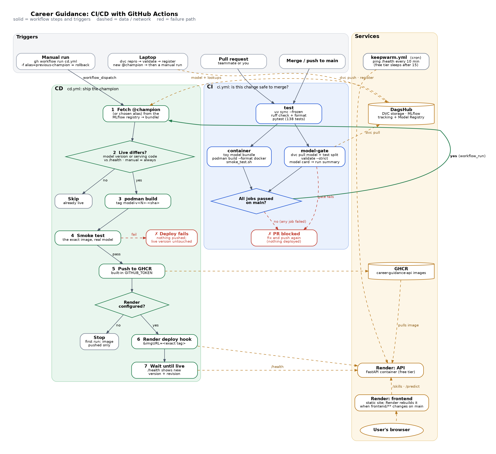

# Phase 2: Productionization & Deployment

Phase 2 deliverables: **model testing, model-risk/quality checks, model registry, FastAPI inference
service, container image, CI/CD, deployment.**

This document has three parts:

1. **[How it works](#part-1-how-it-works)**: the architecture and every moving piece, including a
   detailed walkthrough of the CI/CD pipeline and the GitHub Actions syntax it uses.
2. **[Runbook](#part-2-runbook-the-commands-you-run)**: the commands to run, in order, to set
   everything up and do the demo.
3. **[Teammate briefs](#part-3-teammate-briefs)**: the three tasks handed to teammates (B and C are done and merged).

---

## Part 1: How it works

### 1.1 The big picture

```
 DEVELOP (laptop)                    GOVERN (DagsHub)                 SHIP (GitHub)                    RUN (Render)
 ────────────────                    ────────────────                 ─────────────                    ────────────
 uv run dvc repro                    MLflow tracking                  pull request
   train@<model> ──── runs ────────▶ (params, metrics)                  │
   select  ──── logs best model ───▶ logged model                       ▼
   validate (quality gate)                                            CI  (ci.yml)
      │                                                                 ├─ lint + unit tests
      ▼                                                                 ├─ Podman build + smoke test (toy model)
 uv run python -m                                                       └─ quality gate on the DVC model
   src.models.register ── version ─▶ Model Registry                     │ merge to main
                                     career-role-classifier            ▼
                                       v1  @previous-champion        CD  (cd.yml)
                                       v2  @champion ◀── reads ─────── ├─ bundle the @champion
                                                                       ├─ Podman build + smoke test (real model)
 uv run dvc push ── data/models ───▶ DVC storage                       ├─ push ──────────▶ GHCR image ──┐
                                                                       └─ deploy hook ──────────────────┼──▶ API (FastAPI container)
                                                                                                        │       ▲  /predict
                                                                     keepwarm.yml ── ping every 10 min ─┼───────┘
                                                                                                        │   frontend (static site)
                                                                                                        └── calls the API from the browser
```

**The core idea: each tool has one job, and every handover is checked.**

| Question | Answered by |
|---|---|
| Which data and code produced this model? | Git + DVC (`dvc.lock`), MLflow run tags (`git_commit`, data md5s) |
| Is this model good *and safe* enough to serve? | The quality gate (`validate` stage) |
| Which model version is served right now? | The MLflow **Model Registry**, alias `@champion` |
| Is this code change safe to merge? | **CI** |
| How does a model get from the registry to users? | **CD**: bundle → image → test → GHCR → Render |
| Exactly what is live? | `/health` → model version + git revision |

### 1.2 Tool choices (and why not the alternatives)

| Need | Chosen | Main alternatives, and why not |
|---|---|---|
| Model registry | **MLflow Registry on DagsHub** | W&B (second tracking system), DVC GTO (separate from our MLflow runs), SageMaker/Vertex (paid, lock-in) |
| Model testing | **pytest + own quality gate** | Deepchecks/Giskard (heavy, generic tabular checks; our input is a skill *list*), Evidently (ruled out by seniors; it's monitoring, Phase 3) |
| Model file | **skops** | pickle/joblib can run arbitrary code when loaded; ONNX can't convert our custom skill tokenizer |
| API | **FastAPI** | Flask (no validation/docs built in), `mlflow models serve` (only raw predict; we also return gap + learning path), BentoML (extra framework) |
| Container | **Podman** | Docker works the same with our Dockerfile; Podman is daemonless and rootless by default |
| Image registry | **GHCR** | Docker Hub (extra account, pull limits), ECR/Artifact Registry (cloud billing) |
| CI/CD | **GitHub Actions** | GitLab CI (repo is on GitHub), Jenkins (self-host a server), CircleCI (extra account) |
| Hosting | **Render (free)** | HF Spaces (Docker Spaces now paid), Cloud Run (needs a card), Fly.io/Koyeb (no free tier for new users) |

### 1.3 The quality gate: `src/models/validate.py` (DVC stage `validate`)

Runs after `select` on `models/model.joblib` and checks it against `params.yaml → validate`.
"Accurate" is not enough to serve a model, so it checks several kinds of risk:

| Kind | Check | Threshold | Why |
|---|---|---|---|
| Performance | top-3 on 5-skill inputs | ≥ 0.75 | Objective O1 |
| Performance | margin over profile matching | ≥ 0.05 | ML must beat a plain skill-matching rule |
| Drift | top-3 on 2019 postings | ≥ 0.60 | floor under 2019→2025 market drift |
| **Calibration** | ECE of top-1 confidence | ≤ 0.10 | the app *shows* confidence %; it must mean something |
| Slices | worst family / worst role top-3 | ≥ 0.60 / ≥ 0.25 | no group of users is badly served |
| Behaviour | 20 hand-written obvious cases | ≥ 90% in top 3 | catches "good numbers, silly answers" |
| Invariance | skill order, duplicates, unknown skills | must not change output | guards future feature changes |
| Robustness | empty skills / missing experience | valid probabilities | the API must never crash or return NaN |
| Operational | model size, p95 single-request latency | ≤ 100 MB, ≤ 100 ms | must fit the free server |

It writes `reports/validation.json` (DVC metric: `uv run dvc metrics show`) and `reports/model_card.md`
(a human-readable summary: intended use, metrics, weakest roles, limitations).

**Real result:** logistic regression passes everything. Raw ComplementNB has the best top-3 (80.0%)
but **fails calibration** (ECE 0.43: it says ~13% when it's right 56% of the time). With isotonic
calibration it passes (80.2% top-3, ECE 0.07). That's the teammate task in Part 3, and the reason
`params.yaml → select.exclude` lists the raw `complement_nb`.

The stage records the report even when the gate fails (so you can read why). The two places that
**enforce** it are `register.py` (won't promote) and CI (`validate --strict` exits 1).

### 1.4 The model registry: `src/models/register.py`

MLflow already *logs* the best model to its run (Phase 1, `select`). Logging ≠ registering:

- **Logged model**: a file attached to one experiment run.
- **Registered model**: a named, versioned entry (`career-role-classifier` v1, v2, …) that
  deployment refers to by **alias**, never by run id.

| Alias | Meaning |
|---|---|
| `@champion` | the version that is served. CD builds the image from `models:/career-role-classifier@champion` |
| `@previous-champion` | the champion it replaced. Rolling back = deploying this alias |
| `@challenger` | passed the gate but didn't beat the champion |

**Promotion rule** (`decide()`): fail the gate → `rejected` (version kept for the record, no alias).
Pass + no champion yet → champion. Pass + top-3 strictly higher than the champion's → champion
(old one becomes previous-champion). Otherwise → challenger.

Each version is tagged with `model_md5`, the same md5 DVC records for `models/model.joblib` in `dvc.lock`.
That links registry ↔ DVC ↔ git: from any registered version you can find the exact commit and data.
Registering the same file twice reuses the version instead of creating a duplicate.

`register.py` also uploads `serving/` (skill profiles, co-occurrence, vocab) and `validation/`
(report + model card) into the model's MLflow run, so a registered version carries everything the
API needs.

Why aliases and not "Staging/Production" stages? MLflow deprecated stages in 2.9; aliases replace them.
Why is registering **not** a DVC stage? It changes shared state on the team server, so a person
decides when it happens (`--dry-run` shows the decision first).

### 1.5 The bundle: `src/serving/bundle.py`

The API never talks to MLflow or DVC. It reads one folder, the **bundle**:

```
bundle/
  model.skops          the pipeline (features + classifier), skops format
  trusted_types.json   the non-sklearn types it needs, checked against TRUSTED_TYPES in train.py
  skill_profiles.json  per-role core skills + 2019→2025 growth
  skill_cooccurrence.npz, skill_vocab.json
  skill_courses.json   skill → up to 3 courses (DVC stage `courses`)
  skill_keyness.json   how skill-like each word is, for resume parsing (DVC stage `resume_keyness`)
  meta.json            model name, registry version, alias, run id, algorithm, metrics
```

`--from-registry` (CD) downloads `models:/career-role-classifier@champion` + its `serving/` files.
`--from-local` (dev) packs `models/` after `dvc pull`. The bundle is copied **into** the image, so
**one image = one exact model**: the image tag says which (`model-v2-a1b2c3d`), and rolling back
means running an older image.

Why skops and not pickle? Loading a pickle can execute arbitrary code. skops refuses any type
not on an allow-list, and `finalise()` checks that list against `TRUSTED_TYPES` before building.

### 1.6 The API: `src/serving/app.py` (+ `recommender.py`, `schemas.py`)

| Endpoint | What it does |
|---|---|
| `GET /health` | status, model name/version/algorithm, **git revision**, feature flags. Used by the Docker HEALTHCHECK, Render, CD and keep-warm |
| `GET /model` | full bundle metadata |
| `GET /skills?q=` | autocomplete for the skill box (prefix matches first, most common first) |
| `GET /roles` | every role the model can predict |
| `POST /predict` | skills + experience → top-k roles, readiness, have/missing, ordered learning path |
| `POST /extract-skills` | resume PDF/DOCX (≤ 5 MB) → skills in the model's spelling, best first (`resume.py`, see `docs/resume_extractor.md`) |
| `GET /docs` | interactive OpenAPI docs, generated by FastAPI |

- **Input handling** mirrors training: skills are lower-cased, tidied and alias-mapped with the same
  `normalise_skill` the pipeline used ("MS Excel" → `excel`). Fewer than 5 *known* skills → 422 with
  the unknown ones and spelling suggestions.
- **Readiness** = share of the role's core-skill weight you already have.
- **Learning path** = missing core skills ordered by
  `share of role postings × (1 + affinity with your skills) × market growth (2019→2025)`.
- **Validation** (Pydantic): bad input (empty list, negative experience, `top_k` > 10) → 422 automatically.
- **Logging**: one JSON line per prediction (version, #skills, top role, confidence, latency):
  the raw material for Phase 3 monitoring. Resume text is never logged.

### 1.7 The container: `Dockerfile`

```
stage "build"    python:3.12-slim + uv → install ONLY base deps + `serve` group from uv.lock
stage "runtime"  python:3.12-slim + libgomp1 → copy .venv, src/, skill_aliases.yaml, bundle/
                 non-root user, HEALTHCHECK on /health, CMD uvicorn on $PORT
```

- **Two stages** keep build tools out of the final image.
- **Dependency groups** (`pyproject.toml`): `pipeline` (DVC, MLflow, profiling) and `dev` (Jupyter,
  pytest) are not installed in the image. A plain `uv sync` on laptops still installs everything.
- **`.dockerignore` is an allow-list**: `data/`, `models/`, `.env` (secrets!) never reach the build.
- **`--format docker` with Podman**: Podman's default OCI format has no HEALTHCHECK field, so the
  healthcheck would be silently dropped. Base images are fully qualified (`docker.io/library/...`)
  so Podman never asks which registry to use.
- **`GIT_SHA` build-arg** → `/health` reports which commit the image was built from.
- **Size ≈ 700 MB**, mostly scipy/pandas/scikit-learn. Memory in use ≈ 250 MB (fits Render's 512 MB).
  On Render's 0.1 CPU the app takes ~3 min to start (loading those libraries); requests then take
  0.3–1 s.

`scripts/smoke_test.sh <image> [expected role]` starts an image, waits for `/health`, runs the
image's own HEALTHCHECK, makes one real prediction and checks the top role. CI and CD both use it.

### 1.8 CI: `.github/workflows/ci.yml` ("is this change safe to merge?")

The whole CI/CD flow in one picture (source: `images/cicd-flow.dot`, re-render with the command at its top):



Triggers: every **pull request**, every **push to main**, and manually.

```
           ┌──────────────── test ────────────────┐
PR/push ──▶│ checkout → uv sync --frozen           │
           │ ruff check → ruff format --check      │
           │ pytest (138 tests, toy data, no secrets)│
           └───────────┬───────────────┬──────────┘
                needs: test       needs: test
                       ▼               ▼
        ┌──── container ─────┐   ┌──────── model-gate ─────────┐
        │ toy bundle          │   │ DVC creds from secrets      │
        │ podman build        │   │ dvc pull model + test split │
        │ smoke_test.sh       │   │ validate --strict           │
        └─────────────────────┘   │ model card → run summary    │
                                  └─────────────────────────────┘
```

- **`test`** fails fast on style or logic errors. `uv sync --frozen` installs exactly what `uv.lock`
  says and fails if the lockfile is out of date, so CI never quietly runs different versions.
- **`container`** proves the Dockerfile builds and the image serves a prediction. It uses the toy
  bundle (`tests/toy_bundle.py`) so it needs no secrets.
- **`model-gate`** runs the quality gate on **the model committed in `dvc.lock`**. If a teammate's
  PR changes the model, CI tells you whether it's servable *before* you merge. It needs the DagsHub
  token, so it's skipped for PRs from forks (GitHub hides secrets from them).
- `container` and `model-gate` both `needs: test` → they run in parallel after `test` passes.
- `concurrency: cancel-in-progress` → pushing again to a PR cancels the outdated run.

### 1.9 CD: `.github/workflows/cd.yml` ("ship the champion")

Triggers:
- **`workflow_run`**: after **CI completes on main**. The job has
  `if: workflow_run.conclusion == 'success'`, so a failed CI never deploys. It checks out
  `workflow_run.head_sha`: **exactly the commit CI tested**, even if main has moved since.
- **`workflow_dispatch`**: by hand, with an `alias` input (`champion` / `previous-champion` / `challenger`).
  Used after `register` promotes a new model (models don't arrive through git) and for **rollback**.

Steps:

| # | Step | Detail |
|---|---|---|
| 1 | checkout (full history) | needed to diff against the live revision |
| 2 | `uv sync --frozen --no-default-groups --group pipeline` | only what's needed to talk to MLflow |
| 3 | **bundle from the registry** | `MLFLOW_TRACKING_*` from secrets/variables; downloads `@champion` (or the chosen alias) |
| 4 | **decide** | see the table below; writes `deploy`, `tag`, `version`, `sha` to `$GITHUB_OUTPUT` |
| 5 | **podman build** | tag `ghcr.io/<owner>/career-guidance-api:model-v<version>-<sha>` + `:latest`, OCI labels (`source` links the package to the repo) |
| 6 | **smoke test the real image** | before anything is pushed: a broken image never reaches GHCR |
| 7 | **push to GHCR** | logs in with the built-in `GITHUB_TOKEN` (`permissions: packages: write`) |
| 8 | **Render deploy hook** | `POST <hook>&imgURL=<exact tag>`: Render runs *this* image, not "whatever latest is" |
| 9 | **wait until live** | polls `/health` until `revision` and `version` match (up to 20 min: Render pulls ~700 MB and the app starts slowly on 0.1 CPU) |

**The decide step:** it compares what *should* be live with what *is* live:

| Situation | Deploy? |
|---|---|
| manual run | always |
| live server unreachable / never deployed | yes |
| registry champion version ≠ live version | yes ("model changed") |
| `src/`, `Dockerfile`, `pyproject.toml`, `uv.lock` or `skill_aliases.yaml` changed since the live revision | yes ("serving code changed") |
| otherwise (e.g. a README-only commit) | no |

Before Render is set up (no `RENDER_DEPLOY_HOOK_URL` secret yet), CD still builds, tests and pushes
the image, then stops with a note. That's how the very first image gets into GHCR.

Other settings: `concurrency: deploy` (never two deploys at once; queued, not cancelled), and
`environment: production` (each deploy appears under the repo's **Deployments** with the live URL; you
can add "required reviewers" there to make deploys need a click of approval).

### 1.10 Keep-warm: `.github/workflows/keepwarm.yml`

Render's free API sleeps after 15 minutes without traffic, and waking takes ~3 minutes. A cron
job pings `/health` every 10 minutes. One always-on service uses ~744 of the 750 free hours/month.
It's a free-tier workaround for the demo: GitHub can delay scheduled runs, and pauses them after 60
days without repo activity. Turn it off after the presentation.

### 1.11 Render: `render.yaml` (Blueprint = hosting as code)

- `career-guidance-api`: `runtime: image`. Render does **not** build anything; it runs the GHCR
  image CD tested. `healthCheckPath: /health` means Render only switches traffic to a new deploy once it's healthy.
- `career-guidance-web`: `runtime: static`. The build command just writes the API URL into
  `frontend/config.js`; `buildFilter` redeploys only when `frontend/` changes. Free static sites
  never sleep and don't use instance hours.

### 1.12 The frontend: `frontend/`

Plain HTML/CSS/JS, no build step. Skill search with autocomplete (only skills the model knows can be
added), resume upload (pre-fills up to 15 skills, best first, for the user to check), experience,
then result cards with confidence, readiness, have/missing skills and the learning path with course links. It waits
for the API to wake up and shows a countdown. All API text is inserted with `textContent`, so
nothing returned by the server can inject HTML.

### 1.13 GitHub Actions in 10 minutes (the syntax our workflows use)

```yaml
name: CI                      # shown in the Actions tab
on:                           # TRIGGERS
  pull_request:               #   any PR
  push: {branches: [main]}    #   pushes to main
  workflow_dispatch:          #   "Run workflow" button / `gh workflow run`
  workflow_run:               #   after another workflow finishes (cd.yml)
  schedule: [{cron: "*/10 * * * *"}]   # timer (keepwarm.yml), UTC

permissions: {contents: read} # what the automatic GITHUB_TOKEN may do (least privilege)
concurrency: {group: ..., cancel-in-progress: true}

jobs:
  test:                       # a JOB = one fresh VM ("runner"); jobs run in parallel unless...
    runs-on: ubuntu-24.04
    steps:
      - uses: actions/checkout@v5          # `uses` = a reusable action from the marketplace
      - run: uv run pytest -q              # `run` = a shell command (bash)
  container:
    needs: test               # ...unless they declare `needs` (ordering + skip if `test` fails)
    if: <expression>          # run conditionally
```

| Concept | In our files |
|---|---|
| `${{ ... }}` expressions | `${{ secrets.DAGSHUB_TOKEN }}`, `${{ inputs.alias \|\| 'champion' }}` |
| **Secrets** (encrypted, masked in logs) | `DAGSHUB_USERNAME`, `DAGSHUB_TOKEN`, `RENDER_DEPLOY_HOOK_URL` |
| **Variables** (plain config) | `MLFLOW_TRACKING_URI`, `RENDER_API_URL` |
| `GITHUB_TOKEN` | created per run automatically; we use it to push to GHCR |
| Step outputs | `echo "tag=..." >> "$GITHUB_OUTPUT"`, then `${{ steps.plan.outputs.tag }}` |
| Run summary | `>> "$GITHUB_STEP_SUMMARY"` (markdown on the run page: model card, deploy result) |
| Cache | `setup-uv` with `enable-cache: true` reuses downloaded packages between runs |

Useful `gh` commands: `gh run list`, `gh run watch`, `gh run view --log-failed`,
`gh workflow run cd.yml -f alias=previous-champion`, `gh pr checks --watch`.

---

## Part 2: Runbook (the commands you run)

Everything below is yours to run. `<owner>` = `AdithyaP-72` (GHCR lowercases it to `adithyap-72`).

### Step 0: What's already done (on the local `phase2` branch)

- All Phase 2 code, tests (138 passing), workflows, Render blueprint, this document. Committed, **not pushed**.
- The teammates' `feature/resume-skills` (which contains `feature/course-recommendations`) is merged
  into `phase2` and wired in: both lookups are part of the bundle, `/extract-skills` uses the real
  extractor, learning-path steps carry course links, and the frontend shows them.
- Local `main` was rewritten to remove the `Co-Authored-By: Claude` line from commit `5adb4e7`
  (same files, authors and dates; only that message changed). Backup of the old history:
  branch `backup/main-before-rewrite`. GitHub still has the old history until Step 7.

### Step 1: Tools

```bash
sudo apt install podman
podman --version                  # expect 4.x or newer
gh auth status                    # GitHub CLI logged in (gh auth login if not)
cd ~/scratch/MLOps && git switch phase2
uv sync                           # installs the new serve group (FastAPI, pypdf, python-docx, ...)
```

### Step 2: Rebuild the pipeline so everything is logged to DagsHub

Your teammate's runs went to a local MLflow file on their laptop, so DagsHub doesn't know them.
Retrain logistic regression (~3 min) so its run lives on DagsHub, then let `select` and `validate` run.

```bash
uv run dvc pull                    # teammate's models/data from DagsHub storage
uv run dvc status                  # expect: select, validate, courses, resume_keyness changed
uv run dvc repro -f -s train@logreg   # -f force, -s only this stage → new run on DagsHub
uv run dvc repro                   # select (picks logreg), validate (the gate), courses (~30 s),
                                   # resume_keyness (~1-2 min)
uv run dvc metrics show            # metrics incl. reports/validation.json and courses_summary.json
cat reports/model_card.md          # expect "Quality gate: PASSED"
grep -E '"best_model"|mlflow_model_uri' reports/metrics.json   # logreg, models:/m-...
ls models/skill_courses.json models/skill_keyness.json         # both exist: register needs them
uv run dvc push                    # upload the new model + lookup files to DagsHub storage
git add dvc.lock reports/ && git commit -m "Retrain logreg against DagsHub MLflow; add validation, courses, keyness"
```

If `select` stops with "was logged to 'local' … can't be reopened", that's the guard telling you
which stage to rerun with `-f -s`.

Order matters here: `register` (Step 3) stores the lookup files **next to the model** in its MLflow
run, and CD only ever downloads them from there. So `courses` and `resume_keyness` must have run
before you register; a model registered without them can't be bundled.

### Step 3: Register the first champion

```bash
uv run python -m src.models.register --dry-run   # shows the decision, changes nothing
uv run python -m src.models.register             # registers v1 and sets @champion
```

Check on DagsHub: repo → **Experiments** → open MLflow UI → **Models** → `career-role-classifier`:
version 1 with alias `champion`, tags `model_md5`, `validation_status=passed`, …

### Step 4: Build and run the real image locally with Podman

```bash
uv run python -m src.serving.bundle --from-registry      # downloads @champion into bundle/
cat bundle/meta.json
podman build --format docker -t career-api:local .
scripts/smoke_test.sh career-api:local Accountant        # health + healthcheck + prediction
podman run --rm -p 8000:8000 career-api:local            # then open http://localhost:8000/docs
# second terminal: the frontend against your local API
cd frontend && python3 -m http.server 5500               # open http://localhost:5500
```

Things to try and understand: `podman images`, `podman ps`, `podman healthcheck run <id>`,
`podman image inspect career-api:local | grep -A3 Healthcheck`, then build once **without**
`--format docker` and notice the warning about HEALTHCHECK.

### Step 5: GitHub secrets and variables

```bash
gh secret set DAGSHUB_USERNAME          # your DagsHub username (paste when prompted)
gh secret set DAGSHUB_TOKEN             # your DagsHub token (paste when prompted; never echo it)
gh variable set MLFLOW_TRACKING_URI --body "https://dagshub.com/AdithyaP-72/Career_Guidance_ML_Ops.mlflow"
gh secret list && gh variable list
```

(`RENDER_DEPLOY_HOOK_URL` and `RENDER_API_URL` come in Step 8.)

### Step 6: Warn your teammates (before Step 7)

The force-push changes the IDs of the last 11 commits on main, and of the two teammate branches
(`feature/course-recommendations`, `feature/resume-skills`) that were built on top of them. Their
work is already merged into `phase2`, so ask them **not to push to those branches any more**: a new
commit there would be on the old history and `--force-with-lease` below would refuse. Changes from
now on go on a new branch from `main` after Step 8.

After Step 7, anyone with those branches checked out re-syncs with:

```bash
git fetch origin
git switch feature/resume-skills && git reset --hard origin/feature/resume-skills   # same for the other
```

and for `main`:

```bash
git fetch origin
git switch main
git reset --hard origin/main            # only if they have NO unpushed work on main
# a local branch with their work, started from the old main:
git rebase --onto origin/main 72780bb their-branch   # 72780bb = the old tip of main
```

### Step 7: Push

```bash
git fetch origin                         # --force-with-lease compares against what you last fetched
git push --force-with-lease origin main feature/course-recommendations feature/resume-skills
                                         # rewritten history; refuses if someone pushed meanwhile
git push -u origin phase2
gh pr create --base main --head phase2 --title "Phase 2: productionization and deployment" \
  --body "Quality gate, model registry, FastAPI service, Podman image, CI/CD, Render. See docs/PHASE2.md."
gh pr checks --watch                     # CI: test, container, model-gate
```

Open the PR's **Checks** tab: the model-gate job's summary shows the model card.
Optional but good for the demo: **Settings → Rules → Rulesets → New branch ruleset** for `main` →
"Require status checks to pass" → add the three CI jobs. Now nothing reaches main without passing CI.

### Step 8: Merge, first image, Render

```bash
gh pr merge --merge                      # keep the individual commits
gh run list --limit 5                    # CI on main, then CD starts by itself
gh run watch                             # CD: bundle → build → smoke test → push to GHCR → stops (no Render yet)
```

Make the image public so Render can pull it: GitHub → your profile → **Packages** →
`career-guidance-api` → **Package settings** → **Change visibility** → Public.

Create the Render services from the blueprint:

1. render.com → sign up with GitHub (free plan, no card).
2. **New → Blueprint** → connect `Career_Guidance_ML_Ops` → branch `main` → it reads `render.yaml`
   and shows 2 services → **Apply**.
3. Wait for `career-guidance-api` to go live (first pull + start ≈ 5 min), then open
   `https://career-guidance-api.onrender.com/health`. If Render gave it a different URL (name
   already taken), put that URL into `render.yaml → API_URL`, commit and push.
4. API service → **Settings → Deploy Hook** → copy the URL.

```bash
gh secret set RENDER_DEPLOY_HOOK_URL     # paste the deploy hook URL
gh variable set RENDER_API_URL --body "https://career-guidance-api.onrender.com"
```

### Step 9: The first real CD run

```bash
gh workflow run cd.yml                   # manual run → always deploys
gh run watch
curl https://career-guidance-api.onrender.com/health    # version 1, revision = main's commit
```

Open `https://career-guidance-web.onrender.com`. The repo's **Deployments** section now lists the
production deploy.

### Step 10: The CI/CD demo: a new champion, then a rollback

1. Teammate opens the calibrated-ComplementNB PR → CI's **model-gate** runs the quality gate on
   *their* model → you review → merge.
2. CD runs automatically (serving code changed → redeploys, still model v1).
3. You promote the new model:
   ```bash
   git switch main && git pull && uv run dvc pull
   uv run python -m src.models.register --dry-run   # expect: champion (beats v1 on top-3)
   uv run python -m src.models.register             # v2 → @champion, v1 → @previous-champion
   gh workflow run cd.yml && gh run watch           # "model changed (v1 → v2)" → deploys v2
   ```
   The site's footer and `/health` now say version 2.
4. Rollback (in case v2 misbehaves):
   ```bash
   gh workflow run cd.yml -f alias=previous-champion && gh run watch   # v1 live again
   gh workflow run cd.yml && gh run watch                              # roll forward to v2
   ```

### Step 11: After the presentation

```bash
gh workflow disable keepwarm.yml
```

### Troubleshooting

| Symptom | Cause / fix |
|---|---|
| `select`: "was logged to 'local'…" | rerun that model's training against DagsHub: `uv run dvc repro -f -s train@<model>` |
| `register`: "MLflow run is not on the team server" | same; `.env` must point at DagsHub |
| Podman asks which registry to use | use full names: `docker.io/library/...` |
| Podman warns "HEALTHCHECK is not supported for OCI image format" | add `--format docker` |
| CI `model-gate` fails at `dvc pull` | secret missing, or someone forgot `uv run dvc push` |
| CI `model-gate` fails at the gate | that's the gate working; read the model card in the run summary |
| CD: push to GHCR "denied" | package settings → Manage Actions access → give this repo Write |
| CD: deploy hook returns 4xx | the hook's `imgURL` must be the same image path as the service's (only the tag may differ) |
| CD: "did not switch within 20 minutes" | Render dashboard → API service → Logs (out of memory? crashed on start?) |
| Site says "Waking up the server…" | normal on the free tier after idling; keep-warm prevents it |

---

## Part 3: Teammate briefs

### A. Calibrated ComplementNB (model owner)

ComplementNB ranks best (80.0% top-3) but its confidence % is far too low (ECE 0.43; the gate allows
0.10). Isotonic calibration fixes it: tested at 80.2% top-3, ECE 0.07, every gate check passing.

1. After `phase2` is merged: `git switch main && git pull && uv sync && uv run dvc pull`, `.env`
   filled in (so runs go to DagsHub), `git switch -c feat/calibrated-cnb`.
2. `src/models/estimators.py`: add
   ```python
   from sklearn.calibration import CalibratedClassifierCV


   def calibrated_complement_nb(alpha=1.0, norm=False, method="isotonic", cv=3):
       """ComplementNB with calibrated probabilities. ensemble=False keeps one model (3x faster to predict)."""
       return CalibratedClassifierCV(ComplementNB(alpha=alpha, norm=norm), method=method, cv=cv, ensemble=False)
   ```
   and `"complement_nb_cal": calibrated_complement_nb` in `MODELS`.
3. `params.yaml`: add `complement_nb_cal` to `train.models` and a block
   `complement_nb_cal: {alpha: 1.0, norm: false, method: isotonic, cv: 3}`.
4. `src/models/train.py`: add `"sklearn.calibration._CalibratedClassifier"` to `TRUSTED_TYPES`;
   `uv run pytest -q`.
   Also in `src/models/evaluate.py`, add `lineterminator="\n"` to the three `.to_csv(...)` calls.
   (On Windows pandas writes `\r\n`; DVC hashes that, git commits `\n`, and everyone else's
   `dvc repro` then retrains every model. This PR retrains everything anyway, so it costs nothing extra.)
5. `uv run dvc repro` (retrains every model, ~1 h, mostly the MLP; this time all logged to DagsHub).
   Check: `reports/metrics.json` → `best_model: complement_nb_cal`, `mlflow_model_uri` starts with
   `models:/` (not null); `reports/model_card.md` → PASSED.
6. `uv run dvc push`, commit `src/models/ params.yaml dvc.lock reports/`, push, open a PR.
   Don't run `register`; that happens after merge.

Tried and rejected: sigmoid calibration (top-3 drops to 64%), temperature scaling (ECE still 0.15),
isotonic with the default `ensemble=True` (123 ms per request, over the 100 ms limit).

### B. Resume → skills: done, merged into `phase2`

`src/serving/resume.py` (rule-based vocabulary matching, Skills-section boost, a "keyness" lookup
learned from job ads to drop everyday words, fuzzy matching for typos) plus the `resume_keyness` DVC
stage. Details and evaluation: `docs/resume_extractor.md`. Wired in as `POST /extract-skills`; the
lookup ships in the bundle so the extractor always matches the served model's vocabulary.

### C. Course links for the learning path: done, merged into `phase2`

`src/models/courses.py`, DVC stage `courses` → `models/skill_courses.json`
(`{skill: [{title, provider, url}]}`), metrics in `reports/courses_summary.json` (coverage, NPTEL
share, 98% relevance on 50 hand-checked pairs). Wired in: each learning-path step in `/predict` has
up to 3 `courses`, shown as links in the frontend.
