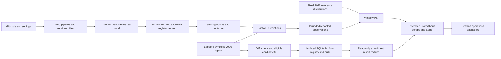

# Phase 3 architecture

CareerCompass trains a classifier on job-posting skills and experience. FastAPI serves a frozen bundle of the classifier and its lookup files. Phase 3 measures how requests and predictions change, then evaluates an experimental challenger under a separate release policy.

| Tool | Role in this project |
|---|---|
| Git and GitHub | Review and version source, workflow definitions and rules |
| DVC and DagsHub storage | Materialize the exact real datasets and model tied to the checkout |
| pandas, PyArrow, NumPy and scikit-learn | Generate reproducible Parquet simulations, transform inputs and fit/calibrate the classifier |
| MLflow | Record experiment metrics and artifacts and assign named versions with aliases |
| FastAPI and Uvicorn | Load the frozen model and serve predictions and authorized telemetry |
| Dockerfile and Compose | Package API dependencies and run the API, Prometheus and Grafana together |
| Prometheus | Scrape counters, histograms and PSI reports and evaluate sustained alert conditions |
| Grafana | Provision a dashboard for API, drift, lineage, retraining and audit evidence |
| GitHub Actions, GHCR and Render | Run CI, publish serving images, and deploy the approved production model |

The original DVC DAG and deployment configuration remain the source of truth for the real production model. The local Compose build uses a separate generated `.phase3/bundle`. It exposes all three services on loopback and sends a file-backed bearer credential to the API scraper. Outside this stack the monitoring routes require an explicitly configured token. The reset endpoint additionally requires the demo flag.

The monitor keeps one bounded, in-memory observation window per API process. It records known vocabulary identifiers, counts unknown inputs, buckets experience and confidence, and records the closed-set predicted role, status, elapsed time and timestamp. Accepted predictions supply the PSI batch to match the accepted 2025 reference population. Counters also cover failed requests. A reset separates replay windows and preserves cumulative Prometheus counters. Prometheus retains aggregated time series for up to 15 days or 512 MB, whichever limit is reached first.

Grafana labels three kinds of evidence. **Live** means this API and the current Prometheus scrape. **Historical** means the last exported DVC lock, committed gate or read-only DagsHub snapshot. **Synthetic** means the lab's replay, fitting and local registry results. An absent panel can indicate missing evidence or insufficient traffic. A DVC lock entry is evidence of a recorded stage, and the GitHub Actions link supplies execution history.

The local retraining command and scheduled Actions job run a controlled labelled replay. Production alerts are evaluated in Prometheus. Connecting alerts to an authenticated job dispatcher and collecting consented, labelled feedback would be separate production work. Current alerts are visible in Prometheus and Grafana. No notification receiver is configured.
